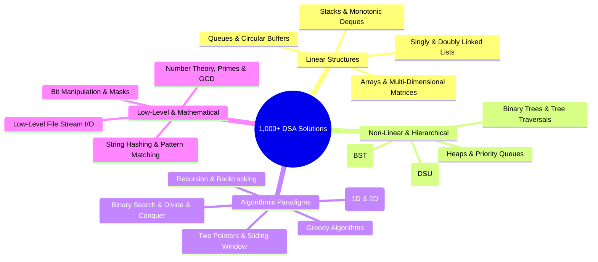

# 🏆 Competitive Programming & DSA Vault — 1,000+ Solved Problems

<div align="center">


[](https://en.wikipedia.org/wiki/C_(programming_language))
[](https://isocpp.org)
[](https://www.oracle.com/java/)
[](https://python.org)
[](https://leetcode.com)
[](https://judge.beecrowd.com)

<br/>

**A vast personal archive of 1,000+ solved algorithms, competitive programming solutions, and data structure implementations.**  
*Solutions to LeetCode, Beecrowd (URI Online Judge), low-level C file handling, and multi-language algorithm translations in C, C++, Java, and Python.*

[📊 Vault Statistics](#-vault-statistics) • [🧠 DSA Topic Distribution](#-dsa-topic-coverage) • [🗂️ Directory Taxonomy](#️-directory-taxonomy) • [⚡ Compilation Guide](#-compilation--execution)

---

</div>

## 📌 About This Vault

This repository represents hundreds of hours of deliberate algorithmic problem-solving. From mastering foundational pointers, memory offsets, and bitwise tricks in pure C to implementing complex graphs, dynamic programming, and binary search trees on LeetCode and Beecrowd, every file is an independently verified, judge-accepted solution.

---

## 📊 Vault Statistics

| Track / Section | Primary Language(s) | Solved Count | Focus & Description |
|:---|:---:|:---:|:---|
| 🐝 **Beecrowd (URI Judge)** | C, C++ | **256** | Structured competitive programming problems spanning mathematics, ad-hoc, strings, and computational geometry |
| 🧩 **LeetCode Solutions** | C++, Java, Python | **164** | Technical interview problems: arrays, two pointers, sliding window, trees, linked lists, and dynamic programming |
| 💻 **Multi-Language Algorithms** | C, C++, Java, Python | **551** | Core algorithmic paradigms, recursion, sorting, data structure implementations, and lab exercises |
| ☕ **Java Practices** | Java (SE) | **88** | Object-oriented design, algorithmic puzzles, collections framework, and clean API design |
| 📁 **File Handling Lab** | C, C++ | **33** | Low-level file streams (`fopen`, `fread`, `fwrite`, `fseek`), binary persistence, and buffer management |
| **Total Verified Files** | | **1,090+** | |

---

## 🧠 DSA Topic Coverage



---

## 🗂️ Directory Taxonomy

```plaintext
All-my-codes-here/
└── Codes/
    ├── Beecrowd using C and C++/       # 256 judge-accepted solutions from Beecrowd URI
    ├── leetcode/                       # 164 interview-level algorithm challenges
    ├── Codes using C, C++, Java.../    # 551 multi-paradigm algorithm implementations
    ├── java practices/                 # 88 Java OOP and algorithmic exercises
    └── File handling/                  # 33 low-level C file pointer and stream scripts
```

---

## ⚡ Compilation & Execution

Each solution is standalone and can be compiled using standard GNU tools:

### C Program Compilation (GCC)
```bash
gcc -O2 "Codes/Beecrowd using C and C++/1001.c" -o solution
./solution
```

### C++ Modern Compilation (G++)
```bash
g++ -std=c++20 -O2 "Codes/leetcode/two_sum.cpp" -o solution
./solution
```

### Java Execution
```bash
cd "Codes/java practices"
javac Solution.java
java Solution
```

### Python Execution
```bash
python "Codes/Codes using C, C++, Java, and Python/solution.py"
```

---

## 📄 License

This repository is maintained for open-source educational reference under the [MIT License](LICENSE).

---

<div align="center">
  <sub>Maintained with relentless dedication by <a href="https://github.com/nahidzaman1996271-sketch">Nahid Zaman</a></sub>
</div>
